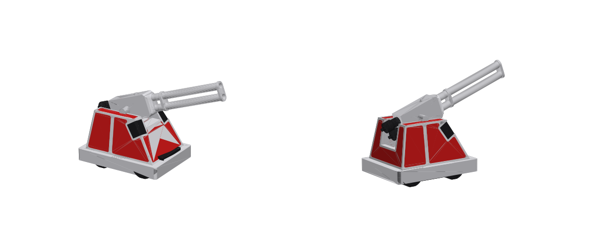

# Glacis desk mini (1:9 printable kit)

This is a printable kit of the rev D.2 body form, with a gun that elevates on a filament pin. It splits across two
CC2s and two CC1s so all four plates print at once, the slowest in about 3 h on Ludicrous. It's generated from the
real model, so rerun it when params change:

- `cad/glacis/mini.py` builds the geometry: body outline, tumble, speaker notches, panel layout, gun parts and pivot;
- `cad/glacis/mini_3mf.py` slices it.



## Size

At 1:9:

- Body: 106.5 x 78.3 x 75.3 mm (4.2 x 3.1 x 3.0 in).
- Wheelbase: 2.22 in. Micah's floor is 2 in, which is 1:10.
- Assembled at 20 deg: 171 mm long and 125 mm tall.

1:9 is the largest round scale whose slowest plate (the body) fits the 3 h Ludicrous budget. `mini_3mf.py --fit`
searched it and found 1:8.91.

## Print (open each project in OrcaSlicer, check the filament slots, send)

| Printer | Project (`cad/glacis/out/mini/`) | Filaments | Balanced estimate | Ludicrous (est.) |
|---|---|---|---|---|
| CC2 #1 | `glacis_mini_CC2-1_body.3mf` | 1 white PETG, 2 black PETG, 3 PLA | 4 h 21 m, 8 changes | ~2 h 55 m |
| CC2 #2 | `glacis_mini_CC2-2_gun.3mf` | 1 white PETG, 2 PLA | 1 h 22 m, 20 changes | ~55 m |
| CC1 #1 | `glacis_mini_CC1-1_black_kit.3mf` | black PETG | 25 m | ~17 m |
| CC1 #2 | `glacis_mini_CC1-2_red_windows.3mf` | red PETG | 17 m | ~11 m |

Notes on the plates:

- **Body:** prints black up to the bumper (wheels and skid), then white.
- **Gun:** prints on its side, so the pin hole comes out round.
- **Black kit:** both speakers, the light bar, and both chambers (standing on their flat faces).
- **Red windows:** all eight windows, flat, outer face down.

All plates use a 0.4 nozzle and Orca's 0.20 mm Standard profile for that printer. Supports are organic with slim
branches (1.5 mm), from the build plate only: under the bumper ring and under the barrels. Their interface is PLA,
which peels off PETG cleanly, so there's no z gap.

"Ludicrous (est.)" divides Orca's Balanced estimate by 1.5. Elegoo's Ludicrous is nominally 166 %, but it only
scales motion, and small parts are acceleration-bound. Those 166 % figures come from CC1 reviews and are assumed for
the CC2.

To print PLA interface on PETG, Orca needs each filament's temperature inside the others' *recommended* range. The
projects widen only those advisory ranges (PETG 210-270, PLA 190-250); print temperatures are unchanged (250 / 210).

## Assemble

1. **Pivot.**
   - Push a 35.5 mm piece of 1.75 mm filament in through the hole in the left bearing block (the robot's left), through
     the gun, until it bottoms out in the right block. The hole is blind, so it can't come out the far side.
   - The hole is 2.05 mm. If it prints tight, run a 2 mm or 5/64 in drill through it by hand.
   - The gun balances on the pin like the real one, so it holds any angle. The well floor stops it at about -1 and
     46 deg.
2. **Windows.**
   - Each red window drops into its pocket, 0.15 mm gap per side, and sits 0.2 mm below the frame face. Use a dot of
     CA in each.
   - The deck pair are notched around the bearing blocks.
   - The pieces are named in the project: front, rear, deck left/right, left/right front/rear.
3. **Speakers.** Each goes into its corner notch with its back face in first.
4. **Light bar.** Seats 0.6 mm into its pocket on the front slant, just above the bumper.
5. **Chambers.** Each slides onto the 2 mm peg on the back of the gun's cradle. The taller one is the top chamber.

## What's simplified

- The windows are 0.6 mm red inserts in 0.8 mm pockets. The real 2.5 mm recess would be 0.28 mm at this scale.
- Bumper foam and backing are one band.
- A skid under the belly gives the body a flat footing. The wheel bottoms are flattened 0.4 mm.
- Gun:
  - fittings under about 1 mm at scale (relief valves, transducers, tubes) are left off;
  - the mantlet, collar and muzzle ring are filled;
  - the barrels are solid, with 4 mm deep muzzle bores.
- The elevation pulley and axle hubs are left off, so the cradle sides run flat 0.4 mm from the bearing blocks.

## Rebuild

From `cad/glacis`:

```
..\.venv\Scripts\python mini.py          # geometry + checks + STLs + previews (~12 s); --scale N for 1:N
..\.venv\Scripts\python mini_3mf.py      # slice the four projects (~20 s, needs OrcaSlicer)
..\.venv\Scripts\python mini_3mf.py --fit   # search the largest scale within the time budget, then build + slice
```

`mini.py` checks each of these, and refuses a wheelbase under 2 in:

- the gun swing, 0-45 deg every 5 deg, against the body with every glue-in in place;
- every glue-in clear of its seat;
- every part and piece is one solid and fits the bed;
- the pin hole is open on the left and blind on the right.

Files:

- `kit.json` lists the pieces;
- `slice_report.json` has the times and grams per plate;
- the Orca profiles are flattened copies of Orca's Elegoo presets, in `cad/glacis/mini_orca/`.
